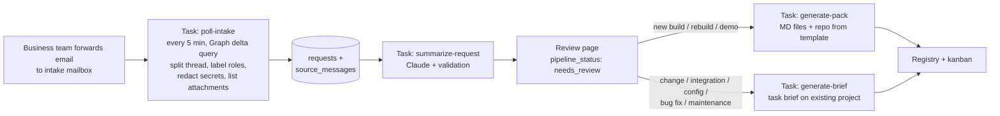

# Architecture

## Flow

Each stage is a separate Trigger.dev task. Statuses live in Postgres. Approving in the UI triggers the next task. No task waits on a human.

## Components

| Part | Runs on | Responsibility |
|---|---|---|
| SvelteKit app (`src/`) | Cloudflare Workers | UI, form actions, triggers tasks via the Trigger.dev SDK |
| Tasks (`trigger/`) | Trigger.dev (Node) | Graph polling, source preparation, Claude calls, validation, pack and brief generation, GitHub API |
| Postgres | Neon (VPS later) | All state. Workers connect through Hyperdrive; tasks connect directly |
| R2 | Cloudflare | Email attachments, generated documents and briefs, raw prompt/response logs per run |
| Cloudflare Access | Cloudflare | Sign-in with Microsoft Entra ID in front of the whole app |

## Projects and requests

- A **project** is a client's site or product: one row in the registry, one card on the kanban.
- A **request** is one intake conversation: a piece of work asked for by email. Every request gets an AI summary.
- `new_build`, `rebuild`, and `demo` requests create a project (or link to one) and produce a project pack.
- `change_request`, `integration`, `platform_config`, `bug_fix`, and `maintenance` requests attach to the client's existing project and produce a task brief. Clients often run on third-party platforms (Shopify, Wix, WordPress, Storyblok, ...); `projects.platform` records which.
- A **partner** is an agency or designer that brings work for its own client (e.g. a branding agency reselling websites). Partners are rows in `clients` with `is_partner = true`; a project has an end client and an optional partner.

## Data model (Drizzle, `src/lib/server/db/schema.ts`)

| Table | Key fields | Notes |
|---|---|---|
| `users` | email, name, role (`admin` / `business` / `dev`) | Created on first sign-in from the Access JWT; role set by admin |
| `clients` | name, is_partner, contacts (jsonb), email_domains (text[]), notes | Personal data: `admin` and `dev` only. `email_domains` drives intake matching |
| `projects` | client_id, partner_id (nullable, -> `clients`), account_manager_id (-> `users`), title, phase, product_type, platform, platform_detail, site_url, tech_stack (jsonb), repo_url, staging_url, production_url, domain_registrar, tools (jsonb) | One row per client site or product |
| `requests` | project_id (nullable until linked), conversation_id, request_type, engagement, urgency, deadline, pipeline_status, work_status (`todo` / `in_progress` / `done`, tasks only), brief_r2_key, new_info_since_approval, secret_flagged | One row per intake conversation |
| `source_messages` | request_id, graph_message_id, part_index, label (`M<n>`), role (`internal_note` / `drp_to_client` / `external`), sender, recipients, sent_at, body_text, source (`email`) | One row per message after thread splitting; unique on (graph_message_id, part_index). Text only, secrets already redacted |
| `attachments` | request_id, source_message_id, label (`A<n>`), kind (`file` / `link`), name, content_type, size, r2_key, url | Files in R2; links stored as URLs. The model sees the list, not the contents |
| `redactions` | request_id, source_message_id, kind, inbox_path, resolved_by, resolved_at | Records that a secret was removed and where it waits in Infisical; never the value |
| `secret_intakes` | graph_message_id (unique), sender, subject, received_at, suggested_project_id, inbox_path, status (`open` / `done`), done_by, done_at | Emails flagged `[SECRET]`; body kept only in Infisical until filed |
| `summaries` | request_id, version, kind (`ai_draft` / `approved`), content (jsonb), created_by | Never overwritten; new version per change |
| `open_questions` | request_id, project_id, type (`technical` / `business`), blocking, question, suggested_answer, answer, answered_by, status | Answers recorded here, not in personal AI sessions |
| `secret_refs` | project_id, key (e.g. `SHOPIFY_ADMIN_TOKEN`), environment (`dev` / `staging` / `production` / `shared`), provider (`infisical`), reference (Infisical path), note, source (`redaction` / `secret_intake` / `manual`), updated_by | One row per variable in the project's ".env"; never the value |
| `templates` | name, kind, body_md | User guide, NDA, etc. |
| `documents` | project_id, template_id, r2_key | Generated outputs |
| `pipeline_runs` | request_id, task, trigger_run_id, model, lesson_ids (int[]), status, failure_reason, log_r2_key | One row per AI run, for debugging and evals; records which lessons were active |
| `review_feedback` | request_id, summary_id, tags (text[]), note, created_by, created_at | Developer's "what did the AI get wrong" on approval (AI_PIPELINE.md section 7) |
| `prompt_lessons` | text, status (`draft` / `active` / `retired`), from_feedback_ids (int[]), eval_result (jsonb), created_by, activated_by | Short rules appended to the summarize prompt; written by staff, never by the model directly |
| `audit_log` | actor, action, entity, entity_id, at, diff (jsonb) | Request status, project phase, summary, secret-ref, redaction, and lesson changes |

## Statuses

`requests.pipeline_status`: `received` -> `summarizing` -> `needs_review` -> `approved` -> `generating` -> `ready`, or `failed` (with `pipeline_runs.failure_reason`) from any running step. A failed step can be retried from the UI. `generating` runs `generate-pack` or `generate-brief` depending on the request type.

`requests.work_status` (task requests only, set by people): `todo`, `in_progress`, `done`.

`projects.phase` (kanban, set by people): `lead`, `proposal` (quote sent or demo in progress), `discovery`, `design`, `build`, `uat`, `deployed`, `maintenance`, `closed`, `lost`.

## Intake rules

- The intake mailbox is read with app-only Graph access, scoped to that one mailbox (see SETUP.md).
- Each forwarded email starts its own conversation in the intake mailbox, so a new `conversation_id` creates a new request in `received`.
- Code then prepares the sources (AI_PIPELINE.md section 1): splits the forwarded thread into messages, labels each message's role from sender and recipient domains, redacts secrets, and saves attachments and shared-file links.
- Intake suggests the client's existing project by matching sender and quoted addresses against `clients.email_domains` and `clients.contacts`. A person confirms the link on the review page; the model never picks the project.
- Replies in an existing conversation attach to that request automatically and trigger a new AI draft. If the request is already approved, the approved version stays and the request is flagged "new info since approval" for a developer to review.
- Follow-up forwards about the same work are merged with a "merge into request" action in the UI.
- Message text comes from Graph with `Prefer: outlook.body-content-type="text"`. Emails forwarded as attachments are read through the item attachment so the original messages stay intact. Whether `uniqueBody` keeps the quoted thread of a forward is open (OPEN_QUESTIONS #13); until verified, use `body` for the first message of a conversation and `uniqueBody` for replies.

## Project secrets (a ".env" per project)

Each project has a list of named secrets that works like a `.env` file: `KEY=value` per environment. Names and Infisical paths live in `secret_refs`; values live only in Infisical, in one folder per project and environment (`/projects/<project-slug>/<environment>`).

How secrets come in:

1. **Flagged email.** The business team forwards an email with `[SECRET]` at the start of the subject. Intake writes the whole body to Infisical (`/inbox/secret-intakes/<id>`), stores only sender, subject, and date in `secret_intakes`, and never sends it to the model.
2. **Detected in a normal email.** Intake redacts it and parks the value in Infisical (AI_PIPELINE.md 1.3).
3. **Typed in by hand** on the project's Secrets tab.

The **Secrets inbox** (admin and dev only) shows open items. For each one the user picks the project, names the variable (code suggests a name from the kind, e.g. `OPENAI_API_KEY`), picks the environment, and saves. The value moves to the project's Infisical folder, a `secret_refs` row is written, and the parked copy in `/inbox` is deleted. Marking a flagged email done also deletes its stored body.

The project's **Secrets tab** lists keys per environment with masked values. Admin and dev can reveal one value or download the environment as a `.env` file. Developers can also pull it with the Infisical CLI (`infisical export --env=<environment> --path=/projects/<project-slug>`). Every reveal, download, add, change, and delete writes `audit_log`.

The app talks to Infisical through its REST API with a machine identity (`INFISICAL_CLIENT_ID` / `INFISICAL_CLIENT_SECRET`), from server code only; values are never sent to the browser except on an explicit reveal or download.

## Auth

Cloudflare Access protects every route with Microsoft Entra ID as the identity provider. A SvelteKit hook verifies the `Cf-Access-Jwt-Assertion` JWT against the team's Access certificates and audience tag, then loads or creates the `users` row. Authorization (roles) is checked in server code on every load and action.

## Security

- **Untrusted input**: email content is data. The model returns JSON only; code decides every side effect. Nothing the model outputs is executed or used as a URL, path, or command. Message roles are set by code from addresses, never by the model or the email text.
- **Least privilege**: Graph `Mail.Read` scoped to the intake mailbox only; no `Mail.Send`. GitHub credentials limited to creating repos and writing contents.
- **Secrets**: platform secrets in Cloudflare/Trigger.dev env vars; client-project secrets in Infisical, referenced by `secret_refs` (see Project secrets). Emails flagged `[SECRET]` never reach the model; secrets found in other emails are redacted at intake and parked in Infisical.
- **Personal data**: client info and secret references visible to `admin` and `dev` roles only; `business` sees projects, requests, summaries, open questions, and phases. Every access to secret references is audited.
- **Logs**: prompts and responses go to R2 with project-level access; secrets and tokens never enter prompts or logs.
- **Retention**: `source_messages` and email attachments are deleted 12 months after a project closes; approved summaries stay (OPEN_QUESTIONS #6).

## Key decisions

| Decision | Why | Rejected |
|---|---|---|
| Fixed pipeline, not an autonomous agent | Same steps every time; far easier to debug and test; model can't take actions | Agent loop with mailbox tools |
| Requests separate from projects | Most incoming mail is small work on an existing client site, not a new project; each needs its own summary and status | One project per email thread |
| Code labels message roles and splits threads | The model can't be talked into treating client text as DRP's direction; citations point at real messages | Model infers who wrote what |
| Attachments listed, not read (v1) | Keeps quotes and contracts out of the model and keeps cost low; developer opens files from the list | Text extraction of PDFs/DOCX into the prompt |
| Trigger.dev for all Graph and AI work | Retries, run logs, long-running calls, Node runtime | n8n (hard for Claude Code to debug), calls inside Workers |
| Cloudflare Workers over Netlify | Cloudflare Access gives SSO without auth code; R2 and Hyperdrive in one place | Netlify + in-app auth |
| Portable Postgres (Neon now, VPS later) over D1 | Must be reachable from both Workers and Trigger.dev, and movable to our own VPS | D1 (awkward outside Workers, not portable) |
| Polling over Graph webhooks (v1) | No subscription renewal, nothing public to expose; 5-minute delay is fine | Change notifications |
| Official WhatsApp Business Platform later; no OpenWA | OpenWA breaks WhatsApp terms, risks number bans, needs an always-on browser session | OpenWA, other unofficial libraries |
| Infisical references, not stored values | A leaked DB must not leak every client's credentials; Infisical can later be self-hosted on our VPS | Encrypted columns, plain text |
