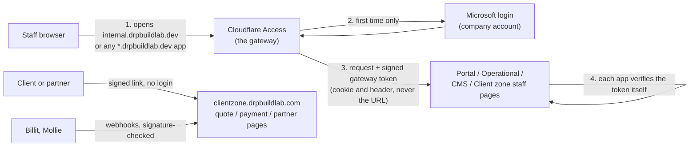

# Internal gateway: one login for all internal apps

DRP BuildLab has several internal apps, each with its own login today. Goal: staff sign in **once** with Microsoft and can open every internal app without signing in again.

Internal apps move to a **separate domain, `drpbuildlab.dev`**, registered on Cloudflare from day one. `drpbuildlab.com` (public website on Netlify, Microsoft 365 email) is not touched, so a mistake on the internal side can never take down the website or email (OPEN_QUESTIONS #27). `drpbuildlab.dev` is the proposed name; confirm it at purchase.

## Apps

| App | Staff address (new) | Hosting | Login today | After the gateway |
|---|---|---|---|---|
| Portal | `internal.drpbuildlab.dev` | Cloudflare Worker | (new) | Lists the apps the signed-in person may open, plus Log out |
| DRP Operational | `operational.drpbuildlab.dev` | Cloudflare Workers | Cloudflare Access | Unchanged (already built this way) |
| CMS | `cms.drpbuildlab.dev` | Netlify (Next.js) | Email + password (Neon Auth), `@drpbuildlab.com` only | Gateway token; password login removed |
| Client zone, staff pages | `clientzone.drpbuildlab.dev` | Netlify (same site) | 7-day `/admin` link in the URL | Gateway token; admin link removed |
| Client zone, client/partner pages | `clientzone.drpbuildlab.com` (unchanged) | Netlify | Signed quote/partner links | Unchanged: clients keep seeing the familiar `.com` address |

Staging stays on its free address: `https://drp-operational-staging.goosebumpsevents.workers.dev`, behind the same Access login.

Until `drpbuildlab.dev` is bought, DRP Operational production also runs on a free address, `https://drp-operational.goosebumpsevents.workers.dev`, behind Access (decided 2026-11-20 to avoid the domain cost for now). Moving it later is a config change (`wrangler.jsonc`, production) plus a new Access application; no data moves.

## Flow

1. A staff member opens `internal.drpbuildlab.dev` (or any app on that domain). Cloudflare Access stops the request before it reaches the app.
2. The first time, they sign in with their Microsoft company account. Access lets in `@drpbuildlab.com` accounts; per app it can require an Entra group (e.g. client zone staff pages: admin + finance).
3. Access issues the **gateway token**: short-lived, signed by Cloudflare, kept in a cookie and passed to the app in the `Cf-Access-Jwt-Assertion` header. The sign-in session is shared, so opening the next app does not ask again.
4. **Each app verifies the token itself** (signature, issuer, its own audience tag, expiry, email). Required because every app also has a second address that skips the gateway (`*.netlify.app`, `*.workers.dev`). DRP Operational already does this (`src/lib/server/auth/access.ts`); the CMS and client zone get the same check.
5. Roles stay inside each app; Access decides who reaches an app, the app decides what they may do.
6. Log out on the portal (`/cdn-cgi/access/logout`) ends the session for all apps.

## Conditions

- **Domain owned by the company**: registered in the company Cloudflare account (`info@drpbuildlab.com`), auto-renew on. An expired domain locks everyone out.
- **No email on `drpbuildlab.dev`**: it never sends mail. Publish `SPF: v=spf1 -all` and `DMARC: p=reject` so nobody can send fake mail from it.
- **`.dev` is HTTPS-only** by design (browsers enforce it); Cloudflare and Netlify both provide certificates.
- **Microsoft sign-in needs an Entra app registration** (tenant admin: the owner) added as login method in Cloudflare Zero Trust.
- **Cost**: the domain (about €10–15 a year). Cloudflare Zero Trust is free up to 50 users.
- **Netlify apps on the new domain**: in Cloudflare DNS, `cms` and `clientzone` point to their Netlify sites (CNAME). Add the domain in the Netlify site first and let Netlify issue its certificate with the record unproxied, then turn on the Cloudflare proxy (orange cloud) so Access stands in front; SSL mode "Full (strict)".
- **Client zone serves two addresses** from one Netlify site: on `clientzone.drpbuildlab.com` the staff pages answer "not found"; on `clientzone.drpbuildlab.dev` they require the gateway token. Client links keep using `.com`.
- **Old staff addresses** (`cms.drpbuildlab.com`, `clientzone.drpbuildlab.com/admin`) redirect to the new ones for a transition period, then stop serving staff pages.

## Why the token is not in the URL

A token in the URL is the weaker choice for staff: it stays in browser history, bookmarks, and screenshots; is written to server and proxy logs; leaks to other websites through the `Referer` header; works for anyone it is forwarded to; and cannot be logged out. In a cookie and header it has none of these problems, expires on its own, and is checked on every request (OPEN_QUESTIONS #24).

## Clients, partners, and webhooks (outside the gateway)

| What | Check | Hardening |
|---|---|---|
| Client quote and payment pages | Signed, expiring link for one quote (`src/links.js` in the client zone) | Short expiry, one quote per link, `Referrer-Policy: no-referrer`, revocable |
| Partner pages | Signed link | Decide later: keep signed links or a partner login (OPEN_QUESTIONS #26) |
| Billit and Mollie webhooks | Signature / re-fetch from the provider | Unchanged; their URLs stay on `.com` |

## Who does what

DRP Operational goes first (steps 1–6); the CMS and client zone (steps 7–8) follow once Operational is in daily use.

| Step | Who | Time |
|---|---|---|
| 1. Turn on Access for the staging link; send AUD tag and team domain | Owner (dashboard) | 5 min |
| 2. Register `drpbuildlab.dev` in Cloudflare (Domain Registration), auto-renew on | Owner | 10 min |
| 3. Entra app registration and Microsoft login method in Zero Trust | Owner (tenant admin) | 15 min |
| 4. API token for setup: Access Apps and Policies Edit, Zone DNS Edit on `drpbuildlab.dev`; put in `.env` as `CLOUDFLARE_SETUP_TOKEN` | Owner | 5 min |
| 5. DNS records, no-mail records, Access applications and policies, Workers custom domains | Claude, with the setup token | |
| 6. Portal at `internal.drpbuildlab.dev`; DRP Operational production at `operational.drpbuildlab.dev` | Claude | |
| 7. CMS: verify the gateway token, remove password login | Claude, in the CMS repo | |
| 8. Client zone: staff pages on `.dev` with the gateway token, hidden on `.com`; remove admin link | Claude, in the client zone repo | |
| 9. Test with a second staff account; then delete the setup token | Owner + Claude | |

**Done when**: a staff member signs in once with Microsoft at `internal.drpbuildlab.dev` and opens Operational, CMS, and client zone staff pages without signing in again; the same pages on their `netlify.app` / `workers.dev` addresses are refused; a client quote link on `clientzone.drpbuildlab.com` and both payment webhooks still work; the CMS password login and the client zone admin link no longer exist; `drpbuildlab.com` website and email were never changed.
