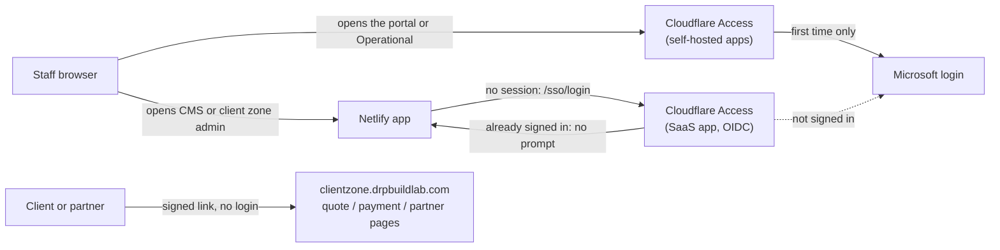

# Internal gateway: one login for all internal apps

DRP BuildLab has several internal apps, each with its own login until now. Goal: staff sign in **once** with Microsoft and can open every internal app without signing in again, starting from a portal page with one tile per app.

## Decisions (owner, 2026-11-21)

- **No new domain for now.** `drpbuildlab.dev` stays unbought (decided 2026-11-20). `drpbuildlab.com` DNS stays off Cloudflare (OPEN_QUESTIONS #27), so Cloudflare Access cannot stand in front of the Netlify apps. Instead, the CMS and client zone use **Cloudflare Access as their OIDC login provider** ("Access for SaaS", generic OIDC). It is the same Access team and the same Microsoft login method, so one sign-in covers every app.
- **Portal**: a new small app, `drp-portal` (SvelteKit on Workers, like Operational), on workers.dev behind Access. Tiles show an icon, name, one-line description and address. No live data.
- **Who**: every `@drpbuildlab.com` staff member may open every app. Roles stay inside each app.
- **Session**: the CMS and client zone keep their own session for **8 hours** after the Access login. When it runs out they go through Access again, which is silent while the Access session lives. Every Log out ends the shared Access session.
- **Straight to Microsoft**: a signed-out visit to the CMS, or to a client zone admin page (also with an expired or invalid admin link), goes straight to the sign-in without a button to click. Nobody needs a new admin link by email any more.
- **Old logins stay until proven**: the CMS password login (Neon Auth, still at `/sign-in` when opened directly) and the client zone 7-day admin link keep working next to the Microsoft sign-in. They are removed in a later change once the new login works on production.
- **Not on CMS deploy previews**: the CMS sign-in variables are set for Netlify's Production context only. Previews keep the password login.
- **Cloudflare setup**: the owner clicks it in the dashboard, following the checklist below. No API token.

The earlier plan (all staff apps on `*.drpbuildlab.dev` behind Access) remains the upgrade path if the domain is bought later. Then the portal and Operational move to custom domains, and nothing else changes for the CMS and client zone.

## Apps

| App | Staff address | Hosting | How it checks the login | Old login (until removed) |
|---|---|---|---|---|
| Portal | `drp-portal.goosebumpsevents.workers.dev` (staging: `drp-portal-staging…`) | Cloudflare Worker | Access in front; verifies `Cf-Access-Jwt-Assertion` | — |
| DRP Operational | `drp-operational.goosebumpsevents.workers.dev` (staging: `drp-operational-staging…`) | Cloudflare Worker | Same as the portal | — |
| CMS | `cms.drpbuildlab.com` | Netlify (Next.js) | OIDC with Access → own cookie `drp_staff`, 8 h | Email + password (Neon Auth) |
| Client zone staff pages | `clientzone.drpbuildlab.com/admin` (staging: `drpbuildlab-clientzone.netlify.app/admin`) | Netlify | OIDC with Access → own cookie `drp_staff` (`Path=/admin`), 8 h | 7-day signed `/admin` link |
| Client zone client/partner pages | `clientzone.drpbuildlab.com` | Netlify | Signed quote/partner links, unchanged | — |

## Flow

1. The first app a staff member opens sends them to Microsoft once. Access then holds a session for its whole team; its length is the Access *global session duration*, 24 hours by default.
2. Portal and Operational: Access stands in front, and each app verifies the Access token itself, because the workers.dev address is also reachable directly.
3. CMS and client zone: with no `drp_staff` cookie they redirect to Access (`/sso/login`, client zone `/admin/sso/login`). Access already knows the person, so it returns at once to `/sso/callback`. The app checks the id_token (signature, issuer, its client ID, nonce, expiry) and a `@drpbuildlab.com` email, then sets `drp_staff` for 8 hours.
4. **Log out** on the portal or Operational opens `/cdn-cgi/access/logout`, which "revokes the user's session across all applications" (Cloudflare docs, Session management). Portal and Operational lock at once. The CMS and client zone have their own Sign out, which clears `drp_staff` and then ends the Access session. A `drp_staff` cookie left in another tab lasts until its 8 hours run out.

## Setup checklist (owner, Cloudflare and Netlify dashboards)

Do staging first and test it (last section) before production. Zero Trust is at one.dash.cloudflare.com → your team.

### 0. Check once

- [ ] **Settings → Authentication → Login methods**: Microsoft Entra ID is there (it is already used by Operational).
- [ ] **Access → Applications → Add an application**: the **SaaS** type is offered. If it is not available on your plan, stop and tell Claude: the CMS and client zone part needs another route.
- [ ] Note your **team domain** (e.g. `drp.cloudflareaccess.com`). It is `ACCESS_TEAM_DOMAIN` / `CF_ACCESS_TEAM_DOMAIN` below.
- [ ] Make one reusable **policy** (Access → Policies → Add): name `DRP staff`, action **Allow**, include **Emails ending in** `@drpbuildlab.com`. Every app below uses it.

### 1. Portal (self-hosted application), staging then production

- [ ] Access → Applications → Add → **Self-hosted**. Name `DRP Portal (staging)`, domain `drp-portal-staging.goosebumpsevents.workers.dev`, policy `DRP staff`, login method Microsoft only (turn on "instant auth" if offered).
- [ ] Copy the **Application Audience (AUD) tag**.
- [ ] In `drp-portal`: `npm run build`, then `npx wrangler deploy --env staging`, then `npx wrangler secret put CF_ACCESS_TEAM_DOMAIN --env staging` and `npx wrangler secret put CF_ACCESS_AUD --env staging`.
- [ ] Production: the same with `DRP Portal`, `drp-portal.goosebumpsevents.workers.dev`, `--env production`.

### 2. CMS (SaaS application, OIDC)

- [ ] Access → Applications → Add → **SaaS**. Application: type `DRP CMS`, choose **OIDC**.
- [ ] **Redirect URL**: `https://cms.drpbuildlab.com/sso/callback`. Add `http://localhost:3000/sso/callback` only if you want Microsoft sign-in in local development. The CMS has no staging site.
- [ ] Scopes: `openid`, `email`, `profile`. Leave PKCE off; the app uses its client secret.
- [ ] Policy `DRP staff`; login method Microsoft.
- [ ] Copy **Client ID**, **Client secret** and **Issuer**.
- [ ] Netlify → the CMS site → Environment variables, **scoped to the Production deploy context only** (otherwise deploy previews redirect to a Cloudflare app that does not know their address): `ACCESS_OIDC_ISSUER` (the Issuer), `ACCESS_OIDC_CLIENT_ID`, `ACCESS_OIDC_CLIENT_SECRET`, `ACCESS_TEAM_DOMAIN`, `STAFF_SESSION_SECRET` (a new random value of 32+ characters, different from every other app) and `CMS_URL` = `https://cms.drpbuildlab.com` (the sign-in builds every redirect from it, because on Netlify the code sees the deploy address instead of the domain). Then redeploy.

### 3. Client zone (SaaS application, OIDC): one app per environment

- [ ] Staging: SaaS → OIDC, name `DRP Client zone (staging)`. Redirect URL `https://drpbuildlab-clientzone.netlify.app/admin/sso/callback`. Scopes, policy and login method as for the CMS.
- [ ] In that Netlify site, set the same five variables (with its own Client ID, secret, Issuer and a new `STAFF_SESSION_SECRET`) plus `ALLOWED_EMAIL_DOMAIN=drpbuildlab.com`. Redeploy.
- [ ] Production: the same, with `DRP Client zone` and `https://clientzone.drpbuildlab.com/admin/sso/callback`, in Dries's Netlify team (you enter the keys yourself; see the client zone's CLAUDE.md).

### 4. Portal tiles

Addresses are in `drp-portal/wrangler.jsonc`. Production links all three apps. Staging links Operational staging and the client zone staging; the CMS tile stays unlinked because the CMS has no staging site.

## Test (done when)

On staging, then production:

1. In a private window, open the portal: Microsoft asks once; the portal shows your email and three tiles.
2. Click **DRP Operational**, **CMS** and **Client zone admin**: each opens without another Microsoft prompt.
3. CMS and client zone admin can save something (e.g. a draft; a setting) while signed in with Microsoft.
4. The portal and Operational on their workers.dev address refuse a request without Access (401). The CMS `/` and client zone `/admin` without a session go straight to the Microsoft sign-in, and so does an old, expired admin link.
5. A client quote link and both payment webhooks (Billit, Mollie) still work; the old CMS password and client zone admin link still work too.
6. **Log out** on the portal; open Operational: Microsoft asks again. **Sign out** in the CMS; open it again: it sends you through Access, which asks for Microsoft.
7. A second staff account can do 1–2. A non-company Microsoft account is refused.

Once this holds on production for a while: remove the CMS password login and the client zone admin link (and the token links in its admin emails) in a separate change.

## Why the token is not in the URL

A token in the URL stays in browser history, bookmarks and screenshots, is written to logs, leaks through the `Referer` header, works for anyone it is forwarded to, and cannot be logged out. Cookies and headers have none of these problems (OPEN_QUESTIONS #24). The old client zone admin link is a URL token, which is why it goes once the Microsoft sign-in is proven.

## Clients, partners, and webhooks (outside the login)

| What | Check |
|---|---|
| Client quote and payment pages | Signed, expiring link for one quote (`src/links.js` in the client zone) |
| Partner pages | Signed link (OPEN_QUESTIONS #26) |
| Billit and Mollie webhooks | Signature / re-fetch from the provider |
